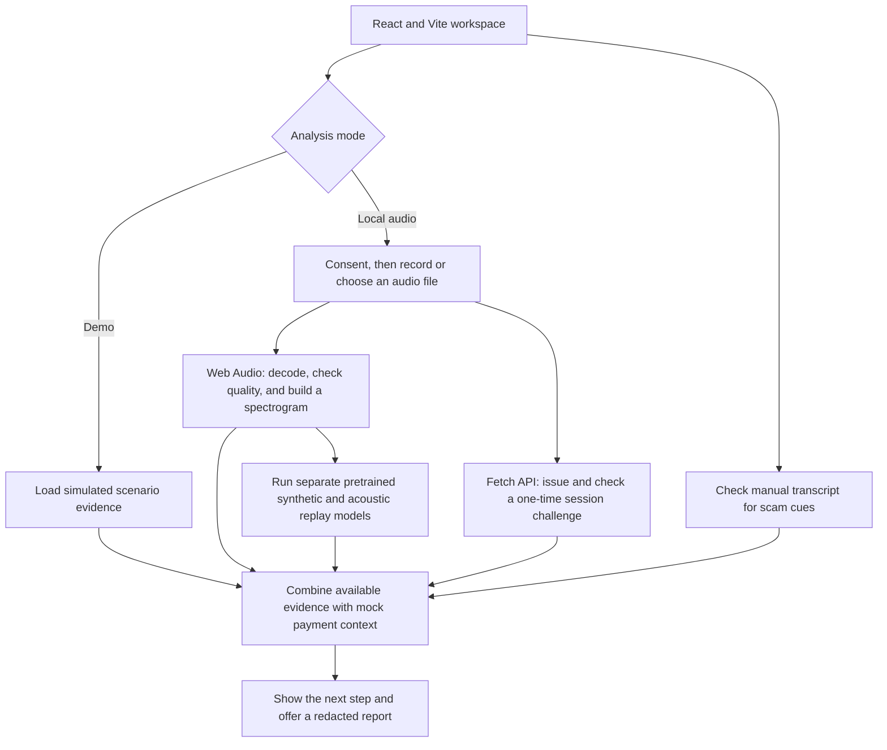

# SpectraGuard

**Built for Raksham: AI Cybersecurity Hackathon**

SpectraGuard is a voice forensics workspace for mock payment decisions. It uses React and Vite for the interface, Web Audio for local analysis, and a Fetch API service for session challenges. The production build packages the app as a Cloudflare Worker.

## Run

Requires Node.js 22.12+ (or a supported newer release).

```sh
npm install
powershell -ExecutionPolicy Bypass -File scripts/download-model.ps1
npm run dev
```

Open http://127.0.0.1:5178. `npm test` runs security, policy, and DSP checks. `npm run build` builds the frontend and `dist/server/index.js` for Sites hosting. The dev server binds to loopback only. Pretrained inference is currently supported by the local app; the standalone Worker excludes the large model and WASM assets.

## What works

- Six explicitly simulated scenarios, searchable session table, separate evidence branches, policy controls, scenario checks, metadata-only activity, and redacted JSON exports.
- Explicit consent before microphone recording or local-file analysis. Recording auto-stops after 12 seconds; supported browser audio files up to 10 MB / 30 seconds. PCM downmix, Hann-windowed FFT, measured STFT, duration/RMS/clipping quality gate. Processing stays in the browser.
- Server-generated 90-second challenge, random nonce, HttpOnly SameSite cookie, one-use consumption, session and mock transaction binding, same-origin checks, request-size limit and per-instance rate limit. A new challenge invalidates the preceding challenge in that browser session.
- Manual English transcript rules for secrecy, urgency, credential requests, payment redirection, and authority claims, with limited negation suppression.
- Retry, reissue, independent verification, and normal-check outcomes. No real payment, account lockout, or actual MFA action.

## What is deliberately unverified

The supplied archive contained research and a proposal, not trained weights or a labeled evaluation corpus. Synthetic and replay scores are simulated in demo cases. Local analysis now runs an external pretrained Wav2Vec2 XLSR synthetic-speech classifier. A separate pretrained ASVspoof PA LFCC–LCNN model now evaluates acoustic replay. Both run locally on the same uploaded audio. Missing or failed inference still triggers independent verification. A spectrogram is not a fraud classifier. No independent accuracy, EER, or FPR evaluation has been performed. Smoke tests establish execution only.

Session freshness validates a submission envelope. The supplied digest is a client assertion; it is not attestation, nor proof that audio was generated after the challenge. The spoken phrase is not ASR-verified. Browser permissions, good audio quality, and a fresh nonce do not prove a physical microphone or exclude a virtual source, client compromise, or live relay. Acoustic replay and injection are separate branches and need independent evaluation.

The challenge store is ephemeral and per process/isolate. Restarts, deployment, and cross-isolate routing can invalidate a session and require a retry. It fails closed. Rate limiting is also per instance, not a global abuse defense. Production requires an authenticated bank-owned session, atomic shared nonce storage (with TTL), reliable rate limiting, trusted capture mechanisms where available, and measured detector calibration. This prototype does not provide those production guarantees.

Audio and manual transcripts are not sent to the server. Server challenge state holds a session identifier, mock transaction fingerprint, expiry, and used marker; expired entries are removed on the next request. A digest is checked and discarded. No application-level request/audio/transcript logging exists. Browser session arrays retain local features and manual text until cleared/reloaded; raw media buffers are released after processing, without a forensic-erasure guarantee. Hosting may keep ordinary request metadata. No localStorage, analytics, or voiceprint database.

## How it was built



## Next research work

1. Independently validate and calibrate the installed synthetic and replay models on representative held-out audio. Keep absent/error states explicit.
2. Calibrate each branch on development data; hold out speakers, generators, source recordings, devices, and rooms in evaluation. Include genuine speakerphone, noisy audio, and assistive speech.
3. Measure EER, recall at fixed FPR, false step-up rates, and p50/p95 latency on named hardware. Compare individual branches with the combined policy.
4. Evaluate capture integrity separately: protocol misuse tests do not measure virtual-microphone detection. Integrate trusted platform telemetry only with a justified threat model.
5. Validate contextual rules across languages, negation, quoting, and benign urgency. Add opt-in local ASR only after privacy and performance review.

References: user-supplied research and SpectraGuard presentation in the sibling `research` directory; [Web Audio AnalyserNode](https://developer.mozilla.org/en-US/docs/Web/API/AnalyserNode); [getUserMedia](https://developer.mozilla.org/en-US/docs/Web/API/MediaDevices/getUserMedia).

## Training and loading experimental models

The local inference adapter accepts separate synthetic and replay JSON artifacts. Train each with `node scripts/train-baseline.mjs manifest.json synthetic synthetic.json` (use `replay` for the other branch). Each manifest row contains `file` (PCM16 WAV), `label` (0 genuine/direct, 1 synthetic/replay), `split` (`train` or `test`), `speaker`, and `source`. Speaker and source identifiers cannot overlap splits. Run with properly licensed data; no evaluation dataset or trained production model is bundled. Load the resulting artifacts under Evaluation lab, then run Local audio. Imported metrics are not independently verified. The baseline uses simple acoustic features and logistic regression, not a validated spectrogram CNN. Scores are experimental model outputs, not calibrated fraud probabilities. The default policy threshold is illustrative and differs from the training report’s 50-point diagnostic threshold.

## Using the pretrained detector

Open **New analysis → Local audio**, give consent, choose an audio file, wait for window-by-window inference, then click **Review local analysis**. The **Spectral analysis** tab shows the synthetic score and **Replay & path** shows the acoustic replay score. Audio stays in the browser. The first model load reads approximately 339 MiB from the local server and may take a minute. Scores are experimental signals, not fraud probabilities; low scores do not certify a genuine speaker. The 90-second submission challenge is refreshed after computation, then consumed once on review; this proves only submission-envelope freshness.

Details, source, checksum, preprocessing and deployment limits are in [the model notes](public/models/README.md). The separate replay model is bundled; see [replay model provenance and tests](public/models/REPLAY.md). Text cues still require a manually supplied transcript.

For evaluation, compare consented human speech with synthetic speech from multiple generators and speakers. All eight generated test WAVs are synthetic, including filenames containing `genuine`; they cannot measure false positives. For replay evaluation, pair direct human recordings with actual loudspeaker playback re-recorded through microphones in different rooms. Uploading a file twice tests neither acoustic replay nor capture-path trust. Keep speakers, recordings, devices and rooms disjoint between training/calibration and final tests. Record false positives, misses and inference time separately for each detector.

### Verification performed

`npm test` covers DSP, policy and nonce security. `npm run test:model` runs the installed ONNX weights with a two-second slice of the included synthetic WAV (mono PCM16 only), verifies finite logits and reports execution timing. This is not a detection-accuracy test. Browser upload of the complete 8.2-second urgency clip produced 66/100, below the illustrative 70-point warning threshold; this known miss demonstrates why no reliability claim or automatic payment decision is appropriate. The same clip's first two seconds scored about 91/100 in the runtime smoke test; segment length and aggregation affect scores.

### Replay model integration

The official ASVspoof2021 PA LFCC–LCNN checkpoint is converted to a ~1.1 MB ONNX model included in Git, with the upstream BSD license and exact frontend coefficients. No Python installation or model import is needed to use replay detection. `npm test` includes frontend agreement, PyTorch-to-ONNX score agreement at multiple lengths, correct score direction, and independent detector failures. This is conversion verification, not a held-out replay accuracy benchmark. The default 70-point threshold is illustrative and must be calibrated before operational use.

The dual-detector browser smoke test returned synthetic 66 and replay 100 on the direct digital TTS urgency sample. Since it was not physically replayed, the replay result is a known false alarm. See the replay model notes before interpreting either score.
